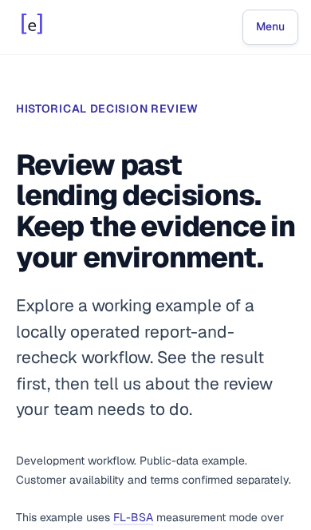
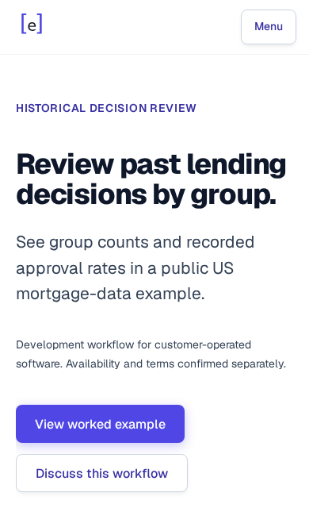

# Historical-review mobile arrival

Issue: https://github.com/equilens-labs/website/issues/107

The opening now names the group-review task and public US mortgage-data example directly. Existing actions precede the unchanged release-track explanation, and the existing example precedes the input/output cards. Development status, customer operation and conditional availability remain before the buttons. All four non-hero sections and every link/script destination are preserved; sample bytes, contact routing and event semantics are unchanged.

`receipt.json` binds the final HTML, viewport measurements and screenshots. At 390×664 the primary action moves from 749px to 510px and the secondary from 811px to 572px, making both visible. The table moves from 2,562px to 1,518px down the page. At 360×640 only the primary fully fits; at 320×568 the primary still requires scrolling. The existing example jump is unchanged and still requires a further scroll to the table. No universal mobile-first-screen or conversion improvement is claimed.

Validation: full repository Playwright suite 524 passed; separate final-file historical-review selection 24 passed with unchanged SHA-256 before/after; HTML conformance 27 deployed pages; content lint; footer metadata guard; whitespace check; four candidate viewport checks with zero main-scope WCAG Axe violations and preserved inspection calls. Independent reviewer A additionally checked 320px keyboard/overflow/accessibility. Two independent reviews, a separate consolidator and root judgement accept the source candidate. The browser checks are emulation with analytics/write requests blocked, not actual LinkedIn-app or inbox-delivery proof. Repository form tests mock acceptance.

This record covers preparation. Public publication remains an operator decision through normal PR/audit/deploy controls. Record the exact deployment SHA/time as a new layout phase; do not reset campaign clocks or infer a causal lift from sequential aggregate observations.
